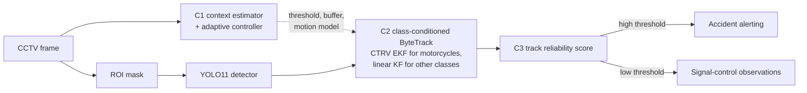

# Motorcycle Tracking in Dense Mixed Traffic

Code, evaluation protocol and manuscript for

> **Tracking Motorcycles in Dense Mixed Traffic: A Class-Conditioned CTRV Filter,
> Seed-Biased Ground Truth and the Cost of Real-Time Input Sizes**
> Trong Nghia Le, Viet Nam Nguyen, Minh Hieu Ho, Xuan Lanh Vo, Thien Bao Nguyen
> University of Economics Ho Chi Minh City (UEH). *Manuscript in preparation.*


Traffic-surveillance pipelines pair a one-stage detector with a tracker that
gives every object the same linear motion model and fixed thresholds.
Motorcycle-dominant traffic strains both choices: motorcycles weave and occlude
one another, so a constant-velocity filter loses them, and one tuned operating
point does not fit every traffic regime. This repository implements a perception
pipeline for fixed CCTV in Ho Chi Minh City with three components. It also holds
the frozen protocol that evaluates them against ByteTrack, OC-SORT and BoT-SORT
on human-annotated footage.

## Contents

- [Pipeline](#pipeline)
- [Main results](#main-results)
- [Repository layout](#repository-layout)
- [Installation](#installation)
- [Quick start](#quick-start)
- [Reproducing the paper](#reproducing-the-paper)
- [Annotation tools](#annotation-tools)
- [Data, weights and licensing](#data-weights-and-licensing)
- [Citation](#citation)

## Pipeline



| | Component | Implementation |
|---|---|---|
| **C1** | Context estimator and adaptive controller. Density, brightness, false-positive rate and time of day select the tracker's confirmation threshold, lost-track buffer and motorcycle motion model online, with EMA smoothing and hysteresis. | [`context_estimator.py`](code/models/context_estimator.py), [`adaptive_controller.py`](code/models/adaptive_controller.py) |
| **C2** | Class-conditioned motion model. Motorcycles are predicted by a constant-turn-rate-and-velocity (CTRV) extended Kalman filter inside ByteTrack, with covariance gating for lost tracks and confidence-scaled measurement noise (NSA). Cars and trucks keep the linear Kalman filter. | [`motorcycle_motion_model.py`](code/models/motorcycle_motion_model.py), [`adaptive_bytetrack.py`](code/tracker/adaptive_bytetrack.py) |
| **C3** | Track reliability score: one score per track, with a precision-first threshold for alerting and a recall-first threshold for signal-control observations. | [`track_reliability.py`](code/models/track_reliability.py) |

ByteTrack's association logic is vendored unchanged ([patch log](code/tracker/vendor/PATCHES.md)),
so the baseline is a true vanilla ByteTrack.

## Main results

The paper evaluates on three 600-frame segments of one camera (dense, mixed and
freeflow) at the 448 px real-time input size. Every tracker consumes the
same detections. This is a **development evaluation on one camera**, not an
independent test.

Motorcycle tracking at 448 px. These numbers are not corrected for seed bias
(see the findings below). From Table 2 of the manuscript; full rows in
[`experiments/paper_final/best85_roi_final/448/summary.md`](experiments/paper_final/best85_roi_final/448/summary.md).

| Configuration | Dense IDF1 | Dense IDSW | Mixed IDF1 | Mixed IDSW | Freeflow IDF1 | Freeflow IDSW |
|---|---|---|---|---|---|---|
| ByteTrack (baseline) | 0.477 | 141 | 0.565 | 19 | 0.516 | 2 |
| + CTRV only | 0.496 | 55 | 0.575 | 4 | 0.523 | 1 |
| C2 (CTRV, gate, NSA) | 0.499 | 62 | 0.574 | 9 | 0.536 | 0 |
| C1 + C2 (+ C3) | 0.496 | 100 | 0.577 | 10 | 0.558 | 2 |
| OC-SORT, matched threshold 0.5 | **0.551** | 39 | **0.646** | 6 | **0.588** | 2 |
| OC-SORT, matched threshold 0.6 | 0.489 | **17** | 0.549 | **3** | 0.515 | 2 |

Findings:

- **C2 cuts identity switches but barely moves IDF1.** On dense traffic it
  reduces motorcycle ID switches against ByteTrack by 56, 38, 29 and 27% at 448,
  640, 960 and 1,280 px. The CTRV model alone accounts for most of the
  reduction. After seed-bias correction, its IDF1 gain on dense and mixed lies
  between −0.001 and +0.026 at every input size.
- **OC-SORT with matched thresholds is the stronger tracker** at the real-time
  input size. Placing C2's motion model inside OC-SORT has no clear effect
  ([evidence](experiments/ocsort_ctrv/evidence.md)).
- **Ground truth seeded from one tracker's pre-labels favours that tracker** by
  about 0.04 IDF1. The bias comes from which boxes the ground truth contains,
  not from their geometry. A blind audit finds 8 of 10 of the other tracker's
  unmatched runs to be real vehicles. The paper brackets and corrects the bias
  ([`experiments/seed_bias/`](experiments/seed_bias/)).
- **The real-time operating point costs accuracy on small motorcycles.** At 448 px
  the detector misses virtually all motorcycles under 20 px tall (99% at 640 px).
  A region-of-interest mask that truncates far vehicles adds to the loss. C2's
  dense IDF1 rises from 0.499 at 448 px to 0.764 at 1,280 px
  ([`experiments/operating_point/`](experiments/operating_point/)).
- **C1 and C3 work as designed but do not improve tracking here.** C1, with
  pre-registered thresholds, holds its dense-peak regime in 80–90% of dense frames
  without improving tracking. C3 filters nothing at its observation threshold.
  In a pre-registered one-clip accident case study, C3 keeps the alert and delays
  it from 0.17 s to 0.23 s
  ([`experiments/c3_accident/`](experiments/c3_accident/)).

**Timing.** The final configurations were not timed. In an earlier CPU sweep
(Intel Core i5-12500H, no GPU), a COCO-pretrained YOLO11n detection head at
448 px ran end to end in 26.6 ms per frame (p95 32.9 ms), against the 40 ms
budget of the 25 fps source. Adjusted for the deployed detector's track count,
this comes to about 36 ms
([`experiments/realtime/evidence.md`](experiments/realtime/evidence.md)).

## Repository layout

```
code/
├── pipeline.py                  end-to-end pipeline with per-component ablation flags
├── models/                      C1 (context estimator, controller), C2 (CTRV EKF), C3 (reliability score)
├── tracker/
│   ├── adaptive_bytetrack.py    class-aware ByteTrack hosting C1/C2
│   ├── ocsort_ctrv.py           OC-SORT with C2's motorcycle motion model (ablation)
│   ├── vendor/                  ByteTrack, association unchanged
│   └── external/                OC-SORT and BoT-SORT baselines (MIT)
├── detection/                   YOLO11 wrapper; legacy severity classifier (outside the paper's scope)
├── evaluation/metrics.py        MOTA, IDF1, fragmentation; cross-checked against py-motmetrics
├── alert/                       rate-limited Telegram alert with a dry-run mode
└── scripts/                     experiment runners, sweeps, GT tools, figures
configs/                         per-experiment YAML (baseline, exp1_C2, exp2_C1C2, exp3_C1C2C3)
tests/                           311 pytest tests
experiments/                     committed results (JSON) and an evidence note per experiment
├── paper_final/                 final runs behind every number in the manuscript, figure script
└── ...                          seed_bias, operating_point, c3_accident, ocsort_ctrv, c1_recalibration, ...
paper/jrtip/                     manuscript (Springer svjour3), bibliography, figures
docs/                            protocols, scope decisions, annotation guides
ket_qua_train/                   training report of the real-time detector (no weights)
```

`paper/main.tex` and `paper/sections/` hold an earlier conference-format draft.
The current manuscript is [`paper/jrtip/main.tex`](paper/jrtip/main.tex).

## Installation

Developed and tested on Windows 11 with Python 3.10, CPU only.

```powershell
py -3.10 -m venv .venv
.venv\Scripts\Activate.ps1
pip install -r requirements.txt -r requirements-dev.txt
```

Run every script as a module from the repository root
(`python -m code.scripts.<name>`). The project package is named `code`, which
shadows a standard-library module ([`code/__init__.py`](code/__init__.py)).

## Quick start

```powershell
# Unit and integration tests
pytest -q

# Synthetic benchmark: needs no footage or weights
python -m code.scripts.run_experiment --config configs/exp1_C2.yaml --synthetic --save-metrics

# Real footage. Falls back to a COCO YOLO11n if the project weights are absent.
python -m code.scripts.run_experiment --config configs/baseline.yaml --video <clip>.mp4 --save-metrics
```

| Config | C1 | C2 | C3 | Experiment |
|---|---|---|---|---|
| [`baseline.yaml`](configs/baseline.yaml) | | | | Exp0: YOLO11 + ByteTrack |
| [`exp1_C2.yaml`](configs/exp1_C2.yaml) | | ✓ | | Exp1: + class-conditioned motion |
| [`exp2_C1C2.yaml`](configs/exp2_C1C2.yaml) | ✓ | ✓ | | Exp2: + context adaptation |
| [`exp3_C1C2C3.yaml`](configs/exp3_C1C2C3.yaml) | ✓ | ✓ | ✓ | Exp3: full pipeline |

## Reproducing the paper

All manuscript numbers come from one frozen runner,
[`run_roi_paper.py`](code/scripts/run_roi_paper.py). It needs three inputs that
are not in the repository: the source video, the reconciled ground-truth receipt
and the detector checkpoint.

```powershell
python -X utf8 -u -m code.scripts.run_roi_paper --phase all --sizes 448 640 960 1280
```

Or double-click `run_paper_experiments.cmd`.

- **Frozen inputs.** The runner hashes the video, checkpoint, ground truth, ROI,
  code and configs into `protocol.json`. A run records its commit in
  `launcher.json`.
- **Resumable.** Detections are cached in hashed 200-frame chunks, so an
  interrupted run resumes, and every tracker reads the same cache.
- **Phases.** `cache → replay → score`, plus `benchmark` for latency, which
  runs one configuration per process after a discarded warm-up.
- **Statistics.** Confidence intervals come from a paired moving-block
  bootstrap (30-frame blocks, 10,000 replicates).

The full protocol is in [`docs/PAPER_EXPERIMENT_WORKFLOW.md`](docs/PAPER_EXPERIMENT_WORKFLOW.md).

Each run's scored summary is committed under
`experiments/paper_final/<run>/<size>/`. The figures are drawn only from those
files, and the manuscript compiles with any LaTeX distribution
(`svjour3.cls` is included):

```powershell
python experiments/paper_final/figures.py   # writes paper/jrtip/figures/*.pdf
cd paper/jrtip; latexmk -pdf main.tex
```

## Annotation tools

The ground truth was built with local review apps, each started by a launcher
in the repository root:

| Launcher | Purpose |
|---|---|
| `review_gt_roi.cmd` | Draw and freeze the per-camera region of interest |
| `review_gt_mixed.cmd`, `review_gt_roi_dense.cmd`, `review_gt_roi_freeflow.cmd` | Review merges, splits and duplicates; edit boxes and classes in a video viewer |
| `review_gt.cmd` | Resolve over-merged identities (cut / keep) |
| `review_gt_audit.cmd`, `review_gt_reconcile.cmd` | Blind audit of tracker–GT disagreements, then reconciliation |
| `review_accident_dataset.cmd` | Clean the detection dataset with source-grouped splits |
| `train_detector_trial.cmd` | Detector training smoke test ([Kaggle notebook](notebooks/CAAP_YOLO11_Kaggle.ipynb) for full runs) |

Guides: [annotation](docs/GT_ANNOTATION_GUIDE.md), [review workflow](docs/GT_REVIEW_WORKFLOW.md),
[audit reconciliation](docs/GT_AUDIT_RECONCILIATION.md).

## Data, weights and licensing

- **Footage.** The source videos are third-party recordings from public online
  sources. They are not redistributed.
- **Annotations and weights.** Annotations, derived data and model weights are
  not in the repository (`data/` and `weights/` are gitignored). Annotations and
  derived data are available from the corresponding author on reasonable request.
- **Credentials.** Telegram credentials belong in the gitignored
  `configs/tele_api.yaml` (template: [`tele_api.example.yaml`](configs/tele_api.example.yaml)).
- **License.** No open-source license is granted for the project code; all
  rights are reserved by the authors. The vendored ByteTrack, OC-SORT and BoT-SORT
  code keeps its original MIT license.

## Citation

```bibtex
@unpublished{Le2026_motorcycle_tracking,
  author = {Le, Trong Nghia and Nguyen, Viet Nam and Ho, Minh Hieu and
            Vo, Xuan Lanh and Nguyen, Thien Bao},
  title  = {Tracking Motorcycles in Dense Mixed Traffic: A Class-Conditioned
            {CTRV} Filter, Seed-Biased Ground Truth and the Cost of Real-Time
            Input Sizes},
  note   = {Manuscript in preparation},
  year   = {2026}
}
```

## Contact

Institute of Intelligent and Interactive Technologies, College of Technology and
Design, University of Economics Ho Chi Minh City (UEH).
Corresponding author: Thien Bao Nguyen, baont@ueh.edu.vn.
