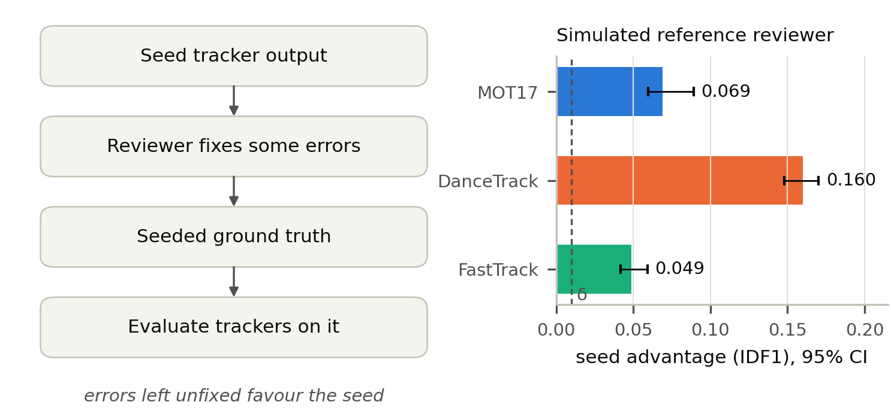

# Seed bias in tracker-assisted MOT ground truth

**How much does a tracker-seeded ground truth favour its seed?**
Code, pre-registered protocol and results for measuring *seed bias* in multi-object tracking (MOT) benchmarks.


<p align="center">
  
</p>

---

## The question

Ground truth (GT) for tracking is expensive, so it is increasingly made by running a tracker and asking people to
correct its output. Every error the reviewer misses stays in the GT, and it is an error the **seed tracker** shares.
Evaluated on that GT, the seed is rewarded for its own mistakes and the other trackers are penalised for being right.

This repository measures that effect. A parametric reviewer model turns a seed tracker's output and the complete
public GT of **MOT17**, **DanceTrack** and **FastTrack** into simulated reviewed GT, so the bias can be measured
against a known truth.

| | Research question |
|---|---|
| **RQ1** | How large is the seed's advantage, and which reviewer errors drive it? |
| **RQ2** | Do seed-correlated errors reorder trackers more than random errors of the same number and length? |
| **RQ3** | Do cheap protocols (union seeding, consensus seeding, bracketing) remove the bias? |

## Main results

All results are at an **assumed** reference reviewer θ<sub>ref</sub> = (r, p<sub>fp</sub>, q, a) = (0.75, 0.1, 0.5, 1),
which is not measured from real annotators; the other 191 reviewer settings are reported descriptively.

| | MOT17 | DanceTrack | FastTrack |
|---|---|---|---|
| Seed advantage, IDF1 (BCa 95%)¹ | **0.069** [0.060, 0.089] | **0.160** [0.148, 0.170] | **0.049** [0.042, 0.059] |
| Rank-agreement loss vs random errors, τ<sub>null</sub> − τ<sub>seed</sub>² | 0.198 | 0.227 | 0.104 |
| Consensus seeding, change in distortion ΔD³ | −0.024 | −0.059 | −0.018 |

¹ Four trackers (SORT, ByteTrack, OC-SORT, BoT-SORT) on a shared YOLO11x detector; intervals over sequences.
² Kendall τ-b over the eight evaluated systems (four trackers × YOLO11x/YOLO11n), GT geometry on both sides (a = 0).
³ Mean absolute error of pairwise IDF1 differences among the four YOLO11x trackers, relative to single-seed GT.

- At θ<sub>ref</sub>, the estimated advantage is larger than every true IDF1 difference between the seed trackers on
  MOT17 and DanceTrack, and than half of them on FastTrack.
- Identity errors left unfixed are the main driver near θ<sub>ref</sub>.
- Consensus seeding reduces the distortion but does not protect trackers left out of it. Union seeding, run after the
  other results with its pre-registered definition, helps little and favours its members. A bracket over single-seed
  GTs never contained the true score.

All numbers, with unrounded values, are in [`results/paper_numbers.json`](results/paper_numbers.json). The full
report is [`results/seed_bias_results.md`](results/seed_bias_results.md).

## Repository layout

```text
code/
├── annotation_sim/simulate.py   seed-then-review GT simulator (prepare once, simulate per reviewer θ)
├── seedbias/                    the study
│   ├── data.py                  dataset loading and shared preprocessing
│   ├── evaluate.py              TrackEval bridge (IDF1, HOTA, CLEAR MOT) for every reported metric
│   ├── track.py, run_tracks.py  the evaluated trackers on cached detections
│   ├── experiment.py            reviewer grid, null model and protocols, per dataset
│   ├── analysis.py              self-seed advantage, rankings, BCa bootstrap
│   ├── null_model.py            random errors matched in number and length (RQ2)
│   ├── protocols.py             union and consensus seeding (RQ3)
│   └── report.py, figures.py, exploratory.py, external_seed.py, paper_numbers.py
├── evaluation/metrics.py        independent IDF1/MOTA used by the tests, cross-checked against motmetrics
└── utils/files.py               hashing and provenance helpers
docs/PROTOCOL.md                 pre-registered protocol with dated amendments A1–A9
notebooks/                       Kaggle notebooks (detection cache, ReID tracker)
paper/                           manuscript (LaTeX), figures, highlights, graphical abstract
results/                         reports and the numbers quoted in the paper
tests/                           pytest suite
tools/                           CLI and the Kaggle scripts
```

## Getting started

Requires Python 3.10 and git (TrackEval is installed from GitHub at a pinned commit).

**Windows (PowerShell)**

```powershell
py -3.10 -m venv .venv
.\.venv\Scripts\python.exe -m pip install -r requirements.txt -r requirements-dev.txt
.\caap.cmd test -q
.\.venv\Scripts\Activate.ps1
$env:PYTHONUTF8 = 1          # the scripts print θ and τ
```

**Linux**

```bash
python3.10 -m venv .venv && source .venv/bin/activate
pip install -r requirements.txt -r requirements-dev.txt
python -m pytest -q
export PYTHONUTF8=1
```

## Reproducing the results

Run from the repository root with the environment activated.

1. **Detections (GPU).** Run [`notebooks/caap-q1.ipynb`](notebooks/caap-q1.ipynb) on Kaggle. It downloads each
   dataset and caches YOLO11x and YOLO11n detections with [`tools/kaggle_detect_cache.py`](tools/kaggle_detect_cache.py).
   Download `dets.zip` from the notebook output and extract it into `data/processed/`, which gives
   `data/processed/dets/<dataset>/<sequence>/` with `det_yolo11x.txt`, `det_yolo11n.txt`, `gt.txt`, `seqinfo.ini`
   and `done.json`.
2. **Trackers.**
   ```powershell
   python -m code.seedbias.run_tracks --dets data/processed/dets --out data/processed/tracks
   ```
3. **Simulation and analysis**, per dataset (several hours on a laptop CPU in total):
   ```powershell
   python -m code.seedbias.experiment --dataset mot17
   python -m code.seedbias.experiment --dataset dancetrack
   python -m code.seedbias.experiment --dataset fasttrack
   python -m code.seedbias.experiment --dataset fasttrack_vehicle --ref-only
   ```
4. **Reports and figures.**
   ```powershell
   python -m code.seedbias.report
   python -m code.seedbias.figures
   python -m code.seedbias.exploratory
   ```
5. **External seed (exploratory).** Copy MPNTrack's MOT17-train outputs from TrackEval's example data
   (`data/trackers/mot_challenge/MOT17-train/MPNTrack/data/*.txt`) to `data/raw/trackeval_example/mpntrack/`, then:
   ```powershell
   python -m code.seedbias.external_seed
   ```
6. **Paper numbers**, last, since it reads every output above (all three datasets, the `fasttrack_vehicle` run,
   `results/exploratory.json` and `results/external_seed_mpntrack.json`):
   ```powershell
   python -m code.seedbias.paper_numbers
   ```

The tracker and simulation steps record the git commit, source hashes and the SHA-256 of every input
(`data/processed/tracks/provenance_<datasets>.json`, `data/processed/seed_bias/<dataset>/provenance.json`, also
embedded in each `summary.json`). The report lists the commit and run key behind each dataset's numbers.

## Pre-registration

The hypotheses, reviewer grid, metrics and stopping rules were frozen in [`docs/PROTOCOL.md`](docs/PROTOCOL.md)
before any result was computed. Every later change is a dated amendment that states whether it was made before or
after the results it affects. Union seeding (A8) was run after the other results, with its definition unchanged, and is
flagged as such; the other analyses added after the results are labelled *exploratory*. A9 pre-registers an
exploratory run of an appearance-based (ReID) tracker; its results are not part of the reported numbers yet. The protocol was
written in Vietnamese; the file is an English translation, and the originals are in the git history.

## Data

All three datasets are public and are downloaded from their official sources by the notebooks. This repository does
not redistribute any video, frame or ground truth; please follow each dataset's license.

| Dataset | Split used | Role |
|---|---|---|
| [MOT17](https://motchallenge.net/data/MOT17/) | train, 7 sequences | pedestrians, crowded street scenes |
| [DanceTrack](https://dancetrack.github.io/) | val, 25 sequences | uniform appearance, diverse motion |
| [FastTrack](https://huggingface.co/datasets/Hamidreza-Hashemp/FastTracker-Benchmark) | train, 12 sequences | urban traffic CCTV, six classes |

## Citation

The paper is under preparation. Until it is published, please cite this repository:

```bibtex
@misc{le2026seedbias,
  author = {Le, Trong Nghia and Nguyen, Viet Nam and Ho, Minh Hieu and Nguyen, Thien Bao},
  title  = {How much does a tracker-seeded ground truth favour its seed? Measuring seed bias in multi-object tracking benchmarks},
  year   = {2026},
  howpublished = {\url{https://github.com/tronghia256-EdgeAI/seed-bias-mot}}
}
```

## Authors

Trong Nghia Le, Viet Nam Nguyen, Minh Hieu Ho and Thien Bao Nguyen, Institute of Intelligent and Interactive Technologies (3ITech),
University of Economics Ho Chi Minh City (UEH), Vietnam.

## License

The code and documentation are released under the [MIT License](LICENSE). Exceptions: the manuscript in
`paper/` (text, figures, highlights, graphical abstract and PDF) is not covered and remains with the authors;
`paper/prletters.sty` is Elsevier's journal style file and keeps its own LaTeX Project Public License; the
datasets keep their own licenses and are not included. The ReID notebook installs BoxMOT (AGPL-3.0) at run time
on Kaggle; no BoxMOT code is included in this repository.
