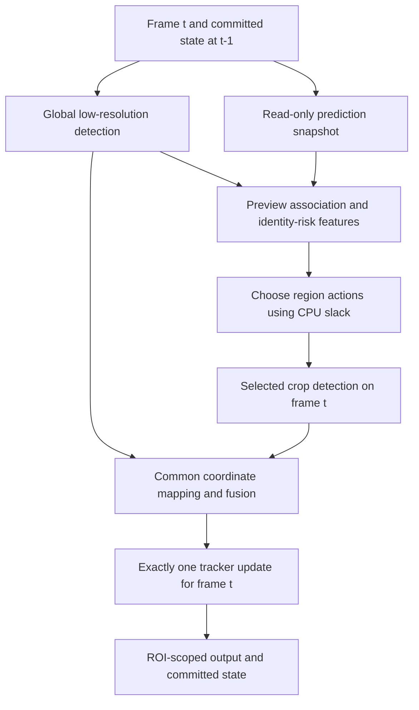

# Minimal method proposal — not implemented

**Status: PROPOSED.** All equations below are design candidates. No calibration,
performance gain, timing guarantee or novelty theorem is established.

## One detector, one backbone, one committed update

Initial configuration: frozen best.pt, global input 448; crop tensor size initially
384 or 640, selected by feasibility; OC-SORT matched as the first backbone. Retain
global 640 as an alternative if measured CPU slack allows it. No RL, ReID network,
super-resolution network, C1 regime controller or C3 downstream branch in the MVP.
ByteTrack is the required second backbone, not an optional last-minute check.

### Causal contract

At decision time the accessible information is

`I_t = {frame_t, state_(t-1), history_<=t-1, low_detections_t, elapsed_time_t}`.

There is no GT or future frame in `I_t`. Preview must not create IDs, increment
frame counters, append observations, age tracks or apply ORU. Final `update` sees
the original committed state and the fused observations once. OC-SORT's current
monolithic `update` predicts internally: **do not call predict on live state and
then call update again**. A read-only mathematical projection or isolated snapshot
is needed. A copied preview that doubles elapsed age is invalid even if scores rise.

Acceptance invariant: no crops → bit-identical IDs/boxes/state progression to the
frozen backbone on the same detections. Include empty detections, reappearance,
crossings, frame gaps and ROI exits. Count preview/copy overhead in timing.

## Scope, source resolution and what crops can recover

The source is 800×450. Detector inputs 960/1280 upscale it. A crop can increase
effective object size in the network; it cannot recover pixels that were never
recorded, were blurred away or were erased by the ROI mask.

Evaluation region `Omega` and the bottom-center rule remain fixed. The current
authorized primary policy masks pixels outside `Omega`. The initial crop policy
must use those same masked source pixels; a rectangle intersecting the ROI does
not authorize unmasked context. Historical filter-only ablations are separate.

A context halo or unmasked global pass is a **future protocol option**, requiring
an explicit recorded scope decision before implementation/test. It is not silently
enabled by this document. If strict masking leaves too little evidence for F1,
report that failure instead of changing the evaluation region to improve results.

For crop rectangle width `w_r`, height `h_r` and square letterbox input `s_r`,
effective scale is `alpha_r = min(s_r/w_r, s_r/h_r)`. A 20-pixel target in a
320-pixel-wide crop at input 640 can become roughly 40 network pixels, versus
roughly 16 in an 800-pixel-wide global input at 640. Exact padding/resize matters.
Processing every crop at 640 can cost as much per call as a global 640 pass;
native crop area alone is not a valid CPU cost proxy.

## M1 — Identity risk, separately from detector uncertainty

Let track `i` have projected center `mu_i`, covariance `P_i^-`, predicted width/
height `(w_i,h_i)` and disappeared-frame count `g_i`. All are pre-update quantities.
Use a normalized projected center covariance:

`S_i = H P_i^- H^T + R_i`,

`D_i = diag(max(w_i,w_min), max(h_i,h_min))`,

`u_i = log(1 + trace(D_i^-1 S_i D_i^-1))`.

`w_min/h_min` prevent tiny boxes exploding. OC-SORT stores area/aspect ratio;
the projection and units must be checked rather than substituting a covariance
trace from a different state representation. Uncertainty is a feature, not an
automatically calibrated probability.

Construct a provisional cost matrix `C` using the backbone's gating geometry
and available low-resolution detections. For each track with two feasible candidates:

`margin_i = C_i,(2) - C_i,(1)`,

`ambiguity_i = exp(-margin_i/tau) * min(1, competition_i)`.

`competition_i` indicates whether a feasible candidate is shared by another track.
No feasible candidate, exactly one candidate and no existing track are distinct
cases; none may be encoded as a confident zero margin. Clutter can cause a low
margin without a real identity problem. This requires calibration and controls.

Start with a three-signal risk model:

`r_i = sigmoid(beta0 + beta_u*u_i + beta_a*ambiguity_i + beta_g*min(g_i,g_max))`.

It estimates a **future identity-failure probability** only after calibration
against appropriate labels. Before then name it an uncalibrated risk index.
Age/confidence/scale/density-only policies are mandatory alternatives, not features
automatically included to make the model elaborate.

| Candidate signal | Available before refinement? | Role/limitation |
|---|---|---|
| Motion covariance | Yes, read-only prediction | Motion uncertainty; not identity ambiguity alone |
| Miss duration | Yes, through t−1 | High values can mean the object has left, not a useful crop |
| Cost margin / competition | Yes, low-resolution provisional association | Pairwise identity ambiguity; could reflect clutter |
| Detection confidence | Yes for coarse candidates; history for missing tracks | Detection support; not a calibrated ID-failure probability |
| Scale | Yes, predicted/coarse boxes | Refinement may help if native pixels are sufficient |
| Local density | Yes, coarse detections/predictions | Under-counts never-detected objects; simple control |
| Occlusion evidence | Only inferred from existing geometry/history | True visibility/occlusion from GT is unavailable online |
| Crop confidence / refined match | **No** | Outcome of an action; illegal as a feature for deciding that same action |

### Calibration and labels

On development clips with trustworthy IDs, define an eligible track-event's label:
an identity switch or fragmentation/rebirth within `H=10` source frames, after a
valid GT correspondence at the decision frame. Report the two failures separately
as well as a predeclared combined label. Right-censored events and ambiguous GT
are excluded from calibration with counts reported, not relabelled as negatives.

Split by recording/trajectory group with temporal guard bands; adjacent windows of
one vehicle cannot land in calibration and validation. Compare AUPRC, Brier score,
reliability curves and failure enrichment at fixed selection coverage. Fit a small
regularized logistic model or a fixed score with scalar calibration. Add signals
only when they improve held-out calibration. Do not fit on camera-test metrics.

Risk ranking is **not** action utility. A fully occluded track can have high `r_i`
and zero crop benefit. This distinction is the central falsification question.

**Smallest M1 test:** F3's blinded development events: can the score beat confidence
plus scale and gap in predicting failures, and do its selected events actually
benefit from a permitted crop? Failure of either test rejects the useful-risk claim.

## M2 — Action-conditioned, budget-constrained refinement

Candidate actions `a=(rectangle, tensor_shape, context_policy)` come from a small
library. Initial cap **one crop per frame**; permit a cap of two only as a registered
later ablation. Avoid one detector call per motorcycle.

Candidate regions:

1. Expand the union of an ambiguous track pair/group, retaining both competitors.
2. Expand a short-gap predicted location, clipped to the authorized source support.
3. Fixed ROI entry/road tiles for discovery, independent of whether low-res YOLO
   has ever created a track there. Merge overlapping rectangles when their measured
   cost/scale is preferable; large merges can destroy the small-object benefit.

Use a finite grid of native crop sizes, for example 160×160 and 320×240 before
clipping, and supported network inputs 384/640. These are starting hypotheses for
F1/F2, not tuned final constants. Store exact clipped rectangles and resize padding.

The quantity we want is

`v(a|I_t) = E[L_ID(t:t+H; no refinement) - L_ID(t:t+H; action a) | I_t]`.

It is an **incremental action benefit**, not `r_i` and not current-frame recall.
Use offline isolated counterfactual replays with future GT to form development
labels; runtime uses only pre-action features. Oracle labels/actions are diagnostic
ceilings, never reported as deployable policies.

MVP utility surrogate:

`V(A) = sum_i r_i * max_(a in A) q_ia + lambda_d * discovery_value(A)`.

`q_ia` estimates whether the crop offers sufficient effective scale, context and
joint competitor coverage to improve association. Initially fit a tiny binned or
linear action-benefit model on development interventions. Compare against simply
setting every `q_ia=1`. The max term avoids counting the same risky track twice.
Do not claim this surrogate equals a HOTA improvement or that arbitrary real
fusion/tracking behavior is monotone/submodular.

### CPU cost and feasibility

`c95(a|load, shape, count)` is an empirical conditional high-quantile cost,
including extraction, preprocessing, inference, remapping and marginal fusion.
Fit it from controlled calibration measurements; compare with a simple per-shape
lookup. Batch size, tensor aspect ratio, call overhead and detection count matter.

Let `e_t` be wall time already spent on decode/global detection/preview/risk.
With reserved final-update/postprocess cost `c_post95` and guard `epsilon`:

`remaining_t = max(0, B_frame - e_t - c_post95 - epsilon)`.

Choose

`maximize V(A) subject to c95(A) <= remaining_t, |A| <= K`.

Start with greedy marginal benefit per incremental measured cost. With `K=1`,
enumerating all feasible candidates and selecting the best is simpler and exact
for the surrogate. For `K=2`, enumerate a small candidate set before introducing
a knapsack solver. Joint costs need not equal summed individual costs.

Decisions occur once per source frame after the global pass; scheduler overhead
is always charged. No feasible crop → use the global detections and update once.
If a crop overruns, record the miss and discard stale-frame reuse; a running model
cannot be assumed cancellable. Do not launch inference on frame t+1 to repair t.

For discovery, test a reserved fraction, initially 20% of refinement opportunities,
cycling over entry tiles; compare with no reserve. Unused reserve returns to identity
actions. This ratio is calibrated on development only. No budget → report delayed
births and starvation, rather than pretending a track-only policy finds unseen bikes.

Primary target is the **40 ms 25-fps service budget**. Secondary 80/120 ms operating
points test a broader compute trade-off; they cannot establish 25-fps real time.
A sliding-window token bucket is a later ablation, with queue delay and deadline
misses reported; saved mean time does not excuse unbounded frame latency.

**Smallest M2 test:** compare this allocation against fixed/periodic/random,
density/confidence and covariance/overlap controls using the identical action
library/fuser and actual cost accounting. No benefit at matched cost → reject the
new scheduler, even if it beats a low-resolution detector with no extra computation.

## M3 — Common detection fusion and commit

For a crop starting at `(x0,y0)`, network box coordinate `(x',y')`, letterbox offset
`(px,py)` and resize factor `alpha`:

`x = x0 + (x' - px)/alpha`, `y = y0 + (y' - py)/alpha`.

Map all corners, clip to source bounds, reject invalid/inverted boxes, retain
floating-point coordinates, then apply the same ROI membership and serialization
rounding rule. Carry frame ID, source rectangle, tensor shape, confidence and class.

Initial fusion is deliberately conservative:

1. Run the same detector with the same low confidence floor for both sources.
2. Match possible duplicates **across sources**, class-wise and one-to-one, with
   high IoU plus normalized center proximity. Keep genuinely neighboring bikes.
3. Retain one box per duplicate group using a fixed development-calibrated source/
   confidence rule. Do not add correlated scores or count the same object twice.
4. Keep unmatched coarse detections, especially at clipped crop edges. An empty
   crop is not evidence that a coarse detection should be deleted.
5. Apply one registered final fusion policy to **every crop-selection baseline**.
   Standard class-wise NMS is the initial control. WBF is optional only if a
   development ablation shows it avoids, rather than creates, merged identities.
6. Feed fused detections to the original tracker update once. Enforce common ROI
   state expiry and record newly born IDs. Selection itself never creates a track ID.

Calibrate detector scores separately from risk if global/crop score distributions
shift. Use class/scale/source-stratified TP labels from independent development GT;
do not claim a calibrated YOLO score from an unvalidated generic temperature trick.
Fusion thresholds and calibration are frozen before locked testing.

**Smallest M3 test:** synthetic coordinate/letterbox/ROI-boundary cases and a short
reviewed crossing clip: no duplicate birth for a cross-source duplicate, no merge
of two neighboring motorcycles, no ID clock advancement on skipped crops. If the
fuser alone explains the gain, use it equally in all controls and reduce the claim.

## Backbone choice and failure modes

OC-SORT is an evidence-supported **candidate** at 448/640, not an assumed universal
winner. Its observation-centric machinery should be preserved. ByteTrack uses
different association/birth rules; log normalized features and action costs for each.
Retain native class handling in published controls; a common class-gated variant
must be named separately. Add a stronger recent motion/confidence backbone if cheap
enough, rather than treating old baselines as automatically sufficient in 2026.

Key falsifiers: no pixels to recover; high-risk crops mostly empty; confidence shift
hurts interior objects; fusion causes duplicate IDs; low-resolution discovery misses
entrants; crop-call cost leaves no slack; association improvements vanish on the
locked camera or after GT adjudication. Each is a result to report, not a reason to
add complexity or retune on test data.
